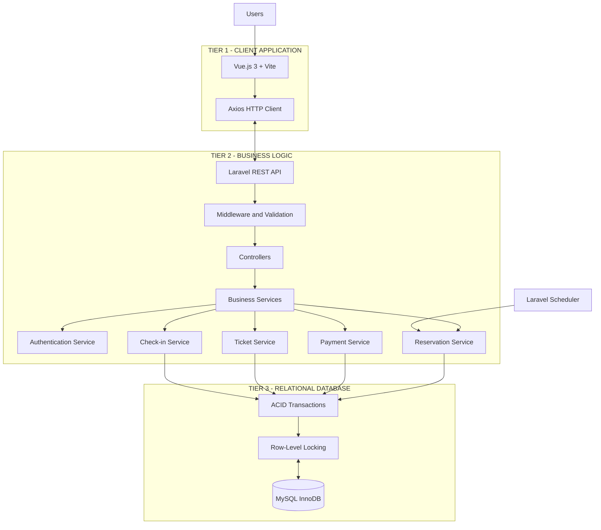
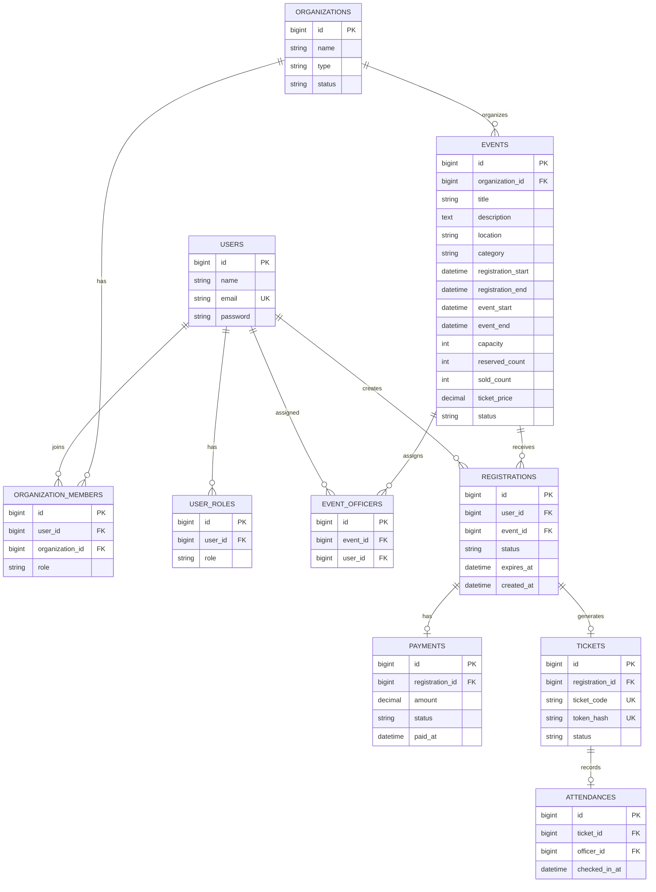

# ARCHITECTURE.md

# CampusEvent
## System Architecture & Technical Design

**Document Type:** Software Architecture Specification  
**Version:** 1.1  
**Project:** CampusEvent  
**Status:** Approved Architecture (Amendment 1)  
**Architecture Pattern:** 3-Tier Architecture + MVC REST API

---

# 1. ARCHITECTURE OVERVIEW

## 1.1 Architecture Description

CampusEvent menggunakan arsitektur 3-Tier yang memisahkan aplikasi menjadi tiga lapisan utama:

1. Client Application (Presentation Layer).
2. Business Logic (Application Layer).
3. Relational Database (Data Layer).

Pemisahan ini bertujuan untuk menjaga struktur aplikasi tetap modular, mempermudah pemeliharaan, serta memastikan proses bisnis dan pengelolaan data berjalan secara terorganisasi.

Frontend dan backend berkomunikasi menggunakan REST API dengan format pertukaran data JSON.

## 1.2 Architecture Objectives

- Memisahkan tanggung jawab frontend, backend, dan database.
- Menerapkan struktur MVC pada backend.
- Menjaga integritas data menggunakan transaksi ACID.
- Mencegah ticket overselling dalam kondisi permintaan bersamaan.
- Menyediakan mekanisme reservasi tiket sementara.
- Menjamin validitas tiket digital dan proses check-in.
- Mempermudah pengembangan dan pengujian setiap modul.

---

# 2. TECHNOLOGY STACK

| Layer | Technology | Responsibility |
|---|---|---|
| Frontend | Vue.js 3 | User Interface |
| Build Tool | Vite | Frontend Development |
| HTTP Client | Axios | REST API Communication |
| Backend | Laravel | Application Backend |
| Architecture | MVC | Business Logic Organization |
| API | REST API | Client-Server Communication |
| Authentication | Laravel Sanctum | Cookie-Based SPA Authentication |
| Database | MySQL InnoDB | Relational Data Storage |
| QR Code | QR Code Library | Digital Ticket Generation |
| Scheduler | Laravel Scheduler | Reservation Expiration |
| Runtime | PHP 8.3.x, Node.js | Application Execution |
| Version Control | Git | Source Code Management |

Frontend dan backend dikembangkan sebagai aplikasi terpisah dalam satu repository atau struktur proyek yang terorganisasi.

---

# 3. THREE-TIER ARCHITECTURE

## 3.1 Tier 1 — Client Application

**Technology:** Vue.js 3 + Vite

Client Application merupakan lapisan yang berinteraksi langsung dengan pengguna.

Responsibilities:

- Menampilkan halaman aplikasi.
- Mengelola komponen antarmuka.
- Menangani navigasi halaman.
- Melakukan validasi input awal.
- Mengelola state aplikasi.
- Mengirim request ke REST API menggunakan Axios.
- Menampilkan respons dari backend.
- Menampilkan informasi status pendaftaran dan tiket.

Frontend tidak memiliki kewenangan untuk menentukan ketersediaan kuota secara final.

Seluruh validasi kritis harus dilakukan kembali oleh backend dan database.

## 3.2 Tier 2 — Business Logic

**Technology:** Laravel MVC + REST API

Lapisan ini bertanggung jawab terhadap seluruh proses bisnis CampusEvent.

Components:

| Component | Responsibility |
|---|---|
| Routes | Mendefinisikan endpoint API |
| Controllers | Menerima dan mengatur request |
| Models | Merepresentasikan data database |
| Services | Menangani logika bisnis |
| Middleware | Mengatur autentikasi dan otorisasi |
| Sanctum | Autentikasi SPA berbasis cookie dan proteksi CSRF |
| Form Requests | Memvalidasi input |
| Jobs / Scheduler | Menangani proses terjadwal |

Business logic utama:

- Authentication dan authorization.
- Organization management.
- Event management.
- Registration management.
- Temporary reservation.
- Payment simulation.
- Ticket generation.
- QR validation.
- Check-in.
- Reporting.

Proses kritis seperti alokasi kuota dan konfirmasi reservasi harus dikelola melalui service khusus dan transaksi database.

## 3.3 Tier 3 — Relational Database

**Technology:** MySQL InnoDB

Database merupakan lapisan penyimpanan seluruh data aplikasi.

Responsibilities:

- Menyimpan data pengguna.
- Menyimpan data organisasi.
- Menyimpan data event.
- Menyimpan pendaftaran.
- Menyimpan reservasi tiket.
- Menyimpan pembayaran.
- Menyimpan tiket digital.
- Menyimpan kehadiran.
- Menjamin konsistensi relasi dan integritas data.

Database menggunakan MySQL InnoDB karena mendukung transaksi ACID, foreign key, dan row-level locking.

---

# 4. SYSTEM ARCHITECTURE DIAGRAM



---

# 5. DATABASE ARCHITECTURE

## 5.1 Database Design Principles

Database CampusEvent dirancang menggunakan relational database dengan prinsip:

1. Setiap tabel memiliki primary key.
2. Relasi antartabel menggunakan foreign key.
3. Data penting memiliki constraint yang sesuai.
4. Data transaksi harus konsisten.
5. Proses alokasi kuota harus menggunakan mekanisme concurrency control.
6. Informasi waktu reservasi menggunakan timestamp yang konsisten.
7. Indeks digunakan pada kolom yang sering digunakan untuk pencarian dan relasi.

## 5.2 Entity Overview

| Entity | Description |
|---|---|
| users | Data pengguna |
| user_roles | Role yang dimiliki pengguna (satu pengguna dapat memiliki beberapa role) |
| organizations | Data organisasi |
| organization_members | Relasi pengguna dan organisasi |
| event_officers | Penugasan petugas check-in pada event |
| events | Data kegiatan |
| registrations | Data pendaftaran |
| payments | Data pembayaran simulasi |
| tickets | Data tiket digital |
| attendances | Data kehadiran |

## 5.3 Entity Relationship Diagram



Catatan: Diagram merupakan rancangan konseptual. Implementasi final harus memperhatikan unique constraints, indeks, tipe data, dan aturan status yang dijelaskan berikutnya.

## 5.4 Data Integrity Rules

### Events

- `capacity` harus bernilai lebih besar dari nol.
- `reserved_count` tidak boleh negatif.
- `sold_count` tidak boleh negatif.
- `reserved_count + sold_count` tidak boleh melebihi `capacity`.
- `location` dan `category` wajib terisi untuk setiap event.
- Perubahan `capacity` tidak boleh membuat `reserved_count + sold_count` melebihi kapasitas baru.

### Registrations

- Satu pengguna hanya boleh memiliki satu pendaftaran aktif untuk event yang sama.
- Setiap pendaftaran harus terhubung dengan pengguna dan event.
- Status pendaftaran harus mengikuti siklus bisnis yang ditetapkan.
- `expires_at` wajib terisi selama status pendaftaran bernilai `PENDING`.
- `expires_at` tidak boleh digunakan kembali sebagai bukti reservasi aktif setelah status berubah menjadi `CONFIRMED`, `EXPIRED`, atau `CANCELLED`.

### Payments

- Setiap pembayaran harus terhubung dengan pendaftaran.
- Nominal pembayaran harus sesuai harga tiket.
- Status pembayaran harus tercatat secara konsisten.
- Setiap pendaftaran memiliki maksimal satu record pembayaran.
- Event gratis tidak membuat record pembayaran.

### Tickets

- Setiap tiket memiliki kode unik.
- Token tiket tidak boleh dapat ditebak.
- Tiket harus terhubung dengan pendaftaran yang valid.
- Satu tiket hanya dapat digunakan satu kali.
- Status tiket hanya boleh bernilai `ACTIVE`, `USED`, atau `VOID`.

### Attendances

- Satu tiket hanya boleh memiliki satu catatan check-in.
- Check-in harus dilakukan oleh petugas yang memiliki otorisasi.
- Petugas hanya boleh melakukan check-in untuk event yang ditugaskan kepadanya.

### User Roles

- Satu pengguna dapat memiliki lebih dari satu role.
- Kombinasi `user_id` dan `role` harus unik.
- Role yang sah adalah `SUPER_ADMIN`, `ORGANIZATION_ADMIN`, `CHECK_IN_OFFICER`, dan `STUDENT`.

### Organization Members

- Kombinasi `organization_id` dan `user_id` harus unik.
- `organization_members.role` hanya berlaku di dalam organisasi terkait dan tidak menaikkan hak akses global pengguna.

### Event Officers

- Kombinasi `event_id` dan `user_id` harus unik.
- Penugasan petugas hanya boleh dilakukan oleh pihak yang berwenang atas event tersebut.
- Petugas check-in hanya boleh mengakses event yang tercatat pada `event_officers`.

## 5.5 Recommended Indexes and Constraints

| Table | Index / Constraint | Purpose |
|---|---|---|
| users | UNIQUE(email) | Mencegah email ganda |
| user_roles | UNIQUE(user_id, role) | Mencegah role ganda pada pengguna yang sama |
| organization_members | UNIQUE(organization_id, user_id) | Mencegah keanggotaan ganda |
| event_officers | UNIQUE(event_id, user_id) | Mencegah penugasan petugas ganda |
| event_officers | INDEX(user_id) | Menampilkan event yang ditugaskan kepada petugas |
| events | INDEX(organization_id, status) | Pencarian event |
| events | INDEX(status, category) | Filter kategori pada event terpublikasi |
| registrations | UNIQUE(event_id, user_id) | Mencegah pendaftaran ganda |
| registrations | INDEX(event_id, status) | Monitoring peserta |
| registrations | INDEX(status, expires_at) | Pemeriksaan reservasi kedaluwarsa |
| payments | UNIQUE(registration_id) | Satu catatan pembayaran |
| tickets | UNIQUE(registration_id) | Satu tiket per pendaftaran |
| tickets | UNIQUE(ticket_code) | Kode tiket unik |
| tickets | UNIQUE(token_hash) | Token unik |
| attendances | UNIQUE(ticket_id) | Mencegah check-in ganda |

Untuk mendukung pendaftaran ulang setelah reservasi kedaluwarsa, sistem dapat memperbarui siklus status pada satu record pendaftaran, bukan membuat record aktif kedua.

## 5.6 Status Enumeration and Transition Rules

Seluruh status disimpan sebagai string dan hanya boleh bernilai sesuai daftar berikut. Validasi transisi status wajib dilakukan di backend sebelum perubahan data disimpan.

### Events

| Status | Deskripsi |
|---|---|
| `DRAFT` | Event dibuat tetapi belum dipublikasikan |
| `PUBLISHED` | Event dipublikasikan dan dapat ditemukan mahasiswa |
| `CLOSED` | Event tidak lagi menerima pendaftaran |
| `CANCELLED` | Event dibatalkan |

Transisi yang diizinkan:

- `DRAFT` → `PUBLISHED`
- `DRAFT` → `CANCELLED`
- `PUBLISHED` → `CLOSED`
- `PUBLISHED` → `CANCELLED`

`CLOSED` dan `CANCELLED` bersifat terminal.

### Registrations

| Status | Deskripsi |
|---|---|
| `PENDING` | Reservasi aktif dan menunggu konfirmasi |
| `CONFIRMED` | Pendaftaran terkonfirmasi dan tiket diterbitkan |
| `EXPIRED` | Reservasi melewati batas waktu |
| `CANCELLED` | Pendaftaran dibatalkan secara administratif |

Transisi yang diizinkan:

- `PENDING` → `CONFIRMED`
- `PENDING` → `EXPIRED`
- `PENDING` → `CANCELLED`
- `CONFIRMED` → `CANCELLED`

`EXPIRED` dan `CANCELLED` bersifat terminal.

### Payments

| Status | Deskripsi |
|---|---|
| `PENDING` | Pembayaran simulasi belum diproses |
| `PAID` | Pembayaran simulasi berhasil (setara "berhasil" pada FR-38) |
| `FAILED` | Pembayaran simulasi gagal |

Transisi yang diizinkan:

- `PENDING` → `PAID`
- `PENDING` → `FAILED`
- `FAILED` → `PENDING`

`PAID` bersifat terminal.

### Tickets

| Status | Deskripsi |
|---|---|
| `ACTIVE` | Tiket valid dan belum digunakan |
| `USED` | Tiket telah digunakan untuk check-in |
| `VOID` | Tiket dibatalkan dan tidak berlaku |

Transisi yang diizinkan:

- `ACTIVE` → `USED`
- `ACTIVE` → `VOID`

`USED` dan `VOID` bersifat terminal.

Transisi status di luar daftar di atas harus ditolak oleh backend.

---

# 6. DATA FLOW ARCHITECTURE

## 6.1 Event Creation Flow

1. Admin Organisasi login.
2. Admin membuka halaman pembuatan event.
3. Frontend mengirim data melalui Axios.
4. Laravel memvalidasi request.
5. Authorization memastikan admin memiliki akses.
6. Event Service memproses data.
7. Data disimpan ke MySQL.
8. Backend mengembalikan respons.
9. Frontend menampilkan event yang berhasil dibuat.

## 6.2 Event Registration Flow

1. Mahasiswa login.
2. Mahasiswa memilih event.
3. Frontend mengirim request pendaftaran.
4. Backend memeriksa identitas dan kelayakan pengguna.
5. Backend memeriksa periode pendaftaran.
6. Registration Service memproses reservasi kuota.
7. Database menjalankan transaksi dan locking.
8. Jika kuota tersedia, sistem mencatat reservasi sementara.
9. Transaksi di-commit.
10. Backend mengembalikan status reservasi.

Jika kuota tidak tersedia, backend mengembalikan respons penolakan.

Untuk event gratis, reservasi dan konfirmasi dilakukan dalam satu transaksi atomik sesuai §6.3.1.

## 6.3 Payment Flow

1. Mahasiswa memiliki reservasi sementara.
2. Sistem menampilkan informasi pembayaran simulasi.
3. Mahasiswa memilih tindakan pembayaran.
4. Backend memvalidasi status dan masa berlaku reservasi.
5. Payment Service memproses simulasi pembayaran.
6. Jika berhasil, reservasi dikonfirmasi.
7. Sistem mengubah status pendaftaran.
8. Sistem mengubah alokasi kuota dari reserved menjadi sold.
9. Sistem menerbitkan tiket digital.
10. Backend mengembalikan informasi tiket.

Jika pembayaran gagal atau reservasi telah kedaluwarsa, sistem tidak menerbitkan tiket.

### 6.3.1 Free Event Flow

Event dengan `ticket_price` bernilai nol tidak membuat record pembayaran.

```text
BEGIN TRANSACTION

1. Lock event inventory row using SELECT FOR UPDATE.

2. Verify event is published and the registration period is active.

3. Read current capacity, reserved_count, and sold_count.

4. Calculate available quota.

5. If available <= 0:
      ROLLBACK
      Return SOLD_OUT.

6. Create or update registration as CONFIRMED.

7. Increment sold_count by 1.
   reserved_count is not modified.

8. Generate digital ticket with status ACTIVE.

9. COMMIT TRANSACTION.
```

Reservasi dan konfirmasi event gratis berada dalam transaksi yang sama sehingga tidak ada status `PENDING` yang bertahan dan tidak ada kuota yang tertahan.

### 6.3.2 Payment Retry and Idempotency

1. Satu pendaftaran hanya memiliki satu record pembayaran.
2. Retry pembayaran menggunakan record pembayaran yang sama selama reservasi masih aktif dan belum `PAID`.
3. Setiap percobaan pembayaran dijalankan secara transaksional.
4. Pembayaran dengan status `PAID` tidak boleh diproses ulang dan tidak boleh menghasilkan tiket duplikat.
5. Pembayaran yang dilakukan setelah `expires_at` terlewati atau setelah status pendaftaran bukan `PENDING` harus ditolak.
6. Request pembayaran berulang harus mengembalikan status terakhir dan tiket yang sudah ada.

## 6.4 Check-in Flow

1. Petugas login.
2. Petugas membuka fitur check-in.
3. Petugas memindai QR Code.
4. Frontend mengirim token tiket ke backend.
5. Backend memverifikasi token.
6. Backend memeriksa status tiket dan event.
7. Backend memastikan petugas ditugaskan pada event tersebut melalui `event_officers`.
8. Backend memeriksa apakah tiket telah digunakan.
9. Jika valid, sistem mencatat kehadiran.
10. Sistem menampilkan status check-in.

---

# 7. REST API ARCHITECTURE

## 7.1 API Convention

Base URL:

`/api/v1`

Communication format:

- Request: JSON.
- Response: JSON.
- Authentication: Laravel Sanctum dengan Cookie-Based SPA Authentication.
- Sesi autentikasi menggunakan cookie; frontend tidak menyimpan token autentikasi di localStorage.
- Setiap request yang mengubah data wajib melalui proteksi CSRF.
- HTTP methods: GET, POST, PUT/PATCH, DELETE.

Seluruh endpoint yang membutuhkan autentikasi harus dilindungi middleware yang sesuai.

## 7.2 API Endpoint Design

### Authentication

| Method | Endpoint | Function |
|---|---|---|
| POST | /auth/register | Registrasi |
| POST | /auth/login | Login |
| POST | /auth/logout | Logout |
| GET | /auth/me | Profil pengguna |

### Organizations

| Method | Endpoint | Function |
|---|---|---|
| GET | /organizations | Daftar organisasi |
| POST | /organizations | Membuat organisasi |
| GET | /organizations/{id} | Detail organisasi |
| PUT | /organizations/{id} | Mengubah organisasi |
| DELETE | /organizations/{id} | Menghapus organisasi |

### Events

| Method | Endpoint | Function |
|---|---|---|
| GET | /events | Daftar event |
| POST | /events | Membuat event |
| GET | /events/{id} | Detail event |
| PUT | /events/{id} | Mengubah event |
| DELETE | /events/{id} | Menghapus event |

### Registrations and Reservations

| Method | Endpoint | Function |
|---|---|---|
| POST | /events/{id}/reservations | Membuat reservasi |
| GET | /registrations | Riwayat pendaftaran |
| GET | /registrations/{id} | Detail pendaftaran |
| POST | /registrations/{id}/cancel | Pembatalan administratif oleh pihak berwenang |

Pembatalan mandiri oleh mahasiswa tidak termasuk cakupan versi 1. Endpoint pembatalan hanya dapat digunakan oleh Super Admin atau Admin Organisasi yang berwenang atas event terkait, dengan aturan pada §9.7.

### Payments

| Method | Endpoint | Function |
|---|---|---|
| POST | /payments/{id}/simulate | Simulasi pembayaran |
| GET | /payments/{id} | Status pembayaran |

### Tickets and Check-in

| Method | Endpoint | Function |
|---|---|---|
| GET | /tickets | Daftar tiket |
| GET | /tickets/{id} | Detail tiket |
| POST | /check-in/validate | Validasi dan check-in |

### Reports

| Method | Endpoint | Function |
|---|---|---|
| GET | /reports/dashboard | Statistik dashboard |
| GET | /reports/events/{id} | Laporan event |
| GET | /reports/attendance/{id} | Laporan kehadiran |

Endpoint dapat disesuaikan selama implementasi dengan tetap mempertahankan fungsi dan batas aksesnya.

---

# 8. TRANSACTION AND ACID ARCHITECTURE

## 8.1 Transaction Strategy

Seluruh proses yang melibatkan perubahan data kritis harus menggunakan transaksi database.

Proses tersebut meliputi:

- Alokasi kuota.
- Pembuatan reservasi.
- Konfirmasi pembayaran.
- Penerbitan tiket.
- Pengembalian kuota.
- Pencatatan check-in.

## 8.2 ACID Implementation

### Atomicity

Operasi yang saling bergantung harus berhasil bersama atau dibatalkan bersama.

Contoh:

Pengurangan kuota dan pembuatan reservasi harus berada dalam transaksi yang sama.

### Consistency

Setiap transaksi harus menjaga aturan integritas data.

Contoh:

Jumlah tiket terjual dan reservasi aktif tidak boleh melebihi kapasitas event.

### Isolation

Transaksi bersamaan harus diproses tanpa menyebabkan konflik alokasi kuota.

Implementasi menggunakan row-level locking melalui `SELECT FOR UPDATE`.

### Durability

Transaksi yang berhasil di-commit harus tetap tersimpan dalam database.

---

# 9. HIGH-CONCURRENCY TICKET RESERVATION

## 9.1 Problem

Sistem harus mampu menangani 100 permintaan pendaftaran bersamaan ketika hanya tersedia lima tiket.

Tanpa concurrency control, beberapa permintaan dapat membaca kuota yang sama dan menyebabkan overselling.

## 9.2 Inventory Model

Kapasitas event menggunakan tiga nilai:

- `capacity`: total kapasitas.
- `reserved_count`: jumlah kuota yang sedang direservasi.
- `sold_count`: jumlah kuota yang telah dikonfirmasi.

Rumus:

`available = capacity - reserved_count - sold_count`

Aturan:

`reserved_count + sold_count <= capacity`

## 9.3 Reservation Algorithm

```text
BEGIN TRANSACTION

1. Lock event inventory row using SELECT FOR UPDATE.

2. Read current capacity, reserved_count,
   and sold_count.

3. Calculate available quota.

4. If available <= 0:
      ROLLBACK
      Return SOLD_OUT.

5. Create or update registration as PENDING.

6. Increment reserved_count by 1.

7. Set reservation expiration time.

8. COMMIT TRANSACTION.

9. Return reservation details.
```

Pemeriksaan pendaftaran ganda harus dilakukan secara aman dan didukung unique constraint database.

## 9.4 Temporary Reservation Policy

Setiap reservasi memiliki masa berlaku:

**10 minutes**

Status reservasi:

- PENDING: reservasi masih aktif.
- CONFIRMED: pembayaran berhasil.
- EXPIRED: waktu reservasi habis.
- CANCELLED: reservasi dibatalkan.

Reservasi yang telah kedaluwarsa tidak boleh dikonfirmasi.

Waktu kedaluwarsa disimpan pada kolom `registrations.expires_at`. Event gratis tidak menggunakan reservasi sementara; konfirmasi dilakukan langsung dalam transaksi reservasi sesuai §6.3.1.

## 9.5 Payment Confirmation

```text
BEGIN TRANSACTION

1. Lock registration row.

2. Verify registration status is PENDING.

3. Verify current time is before expires_at.

4. Verify the payment record belongs to the registration and is not already PAID.

5. Validate payment simulation result.

6. Lock event inventory row.

7. Update payment status to PAID.

8. Change registration status to CONFIRMED.

9. Decrease reserved_count by 1.

10. Increase sold_count by 1.

11. Generate digital ticket.

12. COMMIT TRANSACTION.
```

Jika salah satu operasi gagal, seluruh perubahan harus di-rollback.

Jika pembayaran sudah berstatus `PAID`, transaksi tidak diulang dan sistem mengembalikan tiket yang sudah ada tanpa menerbitkan tiket baru.

## 9.6 Reservation Expiration

Laravel Scheduler menjalankan proses pemeriksaan reservasi yang telah kedaluwarsa.

```text
BEGIN TRANSACTION

1. Find expired PENDING registrations.

2. Lock the selected registration.

3. Recheck registration status and expiration time.

4. Lock associated event inventory.

5. Update registration status to EXPIRED.

6. Decrease reserved_count by 1.

7. COMMIT TRANSACTION.
```

Proses ini harus idempotent agar satu reservasi tidak mengembalikan kuota lebih dari satu kali.

Jika proses pembayaran dan expiration berjalan bersamaan, keduanya harus menggunakan urutan locking yang konsisten dan memeriksa ulang status reservasi sebelum melakukan perubahan.

## 9.7 Administrative Cancellation

Pembatalan mandiri oleh mahasiswa tidak termasuk cakupan versi 1. Pembatalan hanya dilakukan secara administratif oleh Super Admin atau Admin Organisasi yang berwenang atas event terkait.

```text
BEGIN TRANSACTION

1. Lock registration row.

2. Recheck registration status is PENDING or CONFIRMED.

3. If status is PENDING:
      Set registration status to CANCELLED.
      Lock event inventory row.
      Decrease reserved_count by 1.

4. If status is CONFIRMED:
      Set registration status to CANCELLED.
      Set related ticket status to VOID.
      Lock event inventory row.
      Decrease sold_count by 1.

5. COMMIT TRANSACTION.
```

Aturan pembatalan administratif:

1. Kuota hanya boleh dilepas satu kali.
2. Registrasi yang sudah `EXPIRED` atau `CANCELLED` tidak boleh dilepas kembali.
3. Urutan locking konsisten: registration terlebih dahulu, kemudian event inventory.
4. Proses harus transactional dan idempotent.
5. Pembatalan tidak boleh menghasilkan kuota negatif.

---

# 10. CONCURRENCY CONTROL STRATEGY

## 10.1 SELECT FOR UPDATE

Mekanisme ini digunakan untuk mengunci baris inventory event selama transaksi berlangsung.

Tujuannya:

- Mencegah transaksi lain mengubah alokasi kuota pada baris yang sama secara bersamaan.
- Memastikan pembacaan kuota dilakukan terhadap data yang terkunci.
- Menjaga konsistensi proses alokasi.

Lock hanya dipertahankan selama transaksi database berlangsung, bukan selama pengguna melakukan pembayaran.

## 10.2 Idempotency

Sistem harus menangani permintaan berulang agar satu permintaan tidak menghasilkan reservasi atau pembayaran ganda.

Implementasi dapat menggunakan:

- Unique constraints.
- Idempotency key pada request yang memerlukan perlindungan retry.
- Pemeriksaan status transaksi.
- Operasi update yang bersyarat.

Perilaku idempotent yang wajib:

- Konfirmasi pembayaran pada record berstatus `PAID` mengembalikan tiket yang sudah ada tanpa menerbitkan tiket baru.
- Retry pembayaran menggunakan record pembayaran yang sama.
- Pembatalan administratif tidak melepaskan kuota lebih dari satu kali.
- Check-in kedua pada tiket yang sama ditolak.

## 10.3 Deadlock Handling

Sistem harus:

- Menggunakan urutan locking yang konsisten.
- Menjaga transaksi tetap singkat.
- Menghindari operasi eksternal di dalam transaksi.
- Menangani deadlock dengan retry terbatas.
- Mengembalikan respons yang sesuai jika transaksi tetap gagal.

---

# 11. QR CODE AND TICKET SECURITY

## 11.1 Token Generation

Setiap tiket memiliki token acak yang tidak mudah ditebak.

Token tidak menggunakan ID database secara langsung sebagai identitas keamanan tiket.

Sistem menyimpan hash token untuk kebutuhan validasi.

## 11.2 Validation Process

1. QR Code dipindai.
2. Token dikirim ke backend.
3. Backend mencocokkan hash token.
4. Sistem memeriksa status tiket bernilai `ACTIVE`.
5. Sistem memeriksa kesesuaian event.
6. Sistem memeriksa bahwa petugas ditugaskan pada event tersebut.
7. Sistem memeriksa status check-in.
8. Jika valid, sistem mencatat kehadiran secara transaksional.

## 11.3 Duplicate Check-in Prevention

Tabel attendances harus memiliki unique constraint pada `ticket_id`.

Proses check-in juga harus menggunakan transaksi dan validasi ulang status tiket agar dua petugas tidak dapat menggunakan tiket yang sama secara bersamaan.

---

# 12. ERROR HANDLING ARCHITECTURE

Sistem harus menyediakan penanganan kesalahan yang konsisten.

| Condition | Expected Response |
|---|---|
| Kuota habis | Registration rejected |
| Reservasi kedaluwarsa | Reservation expired |
| Pendaftaran duplikat | Duplicate registration rejected |
| Pembayaran gagal | Payment failed |
| Token tidak valid | Invalid ticket |
| Tiket telah digunakan | Ticket already checked in |
| Akses tidak sah | Unauthorized / Forbidden |
| Database transaction gagal | Rollback |
| Terjadi deadlock | Retry terbatas atau transaksi gagal secara aman |

Backend harus menggunakan HTTP status code yang sesuai dan tidak membocorkan informasi internal database kepada pengguna.

---

# 13. SECURITY ARCHITECTURE

Security diterapkan pada seluruh lapisan aplikasi.

## 13.1 Frontend Security

- Validasi input awal.
- Proteksi akses berdasarkan role pada sisi antarmuka.
- Penggunaan HTTPS pada deployment.
- Tidak menyimpan kredensial sensitif secara sembarangan.

## 13.2 Backend Security

- Authentication middleware.
- Role-based authorization.
- Input validation.
- Password hashing.
- Autentikasi SPA menggunakan Laravel Sanctum dengan cookie-based session.
- Proteksi CSRF pada seluruh request yang mengubah data.
- Session regeneration setelah login dan invalidasi session saat logout.
- Konfigurasi cookie `HttpOnly`, `Secure` pada deployment HTTPS, dan `SameSite` yang sesuai.
- Frontend tidak menyimpan token autentikasi di localStorage.
- Rate limiting pada endpoint sensitif.
- Validasi kepemilikan data.
- Pengelolaan token secara aman.

## 13.3 Database Security

- Penggunaan parameterized query melalui mekanisme ORM.
- Foreign key constraints.
- Unique constraints.
- Pembatasan hak akses database.
- Pengamanan kredensial database.
- Backup data secara berkala.

---

# 14. TESTING ARCHITECTURE

Pengujian dilakukan pada beberapa tingkatan.

## 14.1 Unit Testing

Menguji fungsi individual:

- Reservation calculation.
- Quota validation.
- Payment simulation.
- Ticket generation.
- Token validation.
- Reservation expiration.

## 14.2 Integration Testing

Menguji interaksi antarmodul:

- Registration dengan inventory.
- Payment dengan reservation.
- Ticket generation dengan registration.
- Check-in dengan ticket.
- API dengan database.

## 14.3 Concurrency Testing

Pengujian utama proyek:

**Test ID:** CON-001

| Parameter | Value |
|---|---:|
| Initial capacity | 5 |
| Reserved count | 0 |
| Sold count | 0 |
| Concurrent requests | 100 |
| Expected successful reservations | 5 |
| Expected rejected requests | 95 |
| Final available quota | 0 |
| Overselling | 0 |

Hasil pengujian harus memverifikasi:

1. Hanya lima reservasi yang berhasil dibuat.
2. Sembilan puluh lima permintaan ditolak.
3. Kuota tidak pernah menjadi negatif.
4. Jumlah reservasi dan tiket tidak melebihi kapasitas.
5. Tidak ada data pendaftaran ganda.
6. Tidak ada transaksi parsial yang merusak integritas data.

Pengujian menggunakan database MySQL InnoDB yang sebenarnya, bukan hanya SQLite atau mock database, karena perilaku locking harus diuji pada engine database target.

## 14.4 Reservation Expiration Testing

Skenario:

- Reservasi berhasil dibuat.
- Waktu reservasi mencapai batas kedaluwarsa.
- Scheduler atau proses expiration dijalankan.
- Status reservasi berubah menjadi EXPIRED.
- Kuota dikembalikan satu kali.
- Reservasi yang sudah kedaluwarsa tidak dapat dikonfirmasi.

## 14.5 Duplicate Check-in Testing

Skenario:

- Tiket valid dipindai pertama kali.
- Sistem mencatat kehadiran.
- Tiket yang sama dipindai kembali.
- Sistem menolak check-in kedua.

---

# 15. DEPLOYMENT AND DEVELOPMENT ARCHITECTURE

## 15.1 Development Environment

Komponen pengembangan:

- Visual Studio Code.
- PHP 8.3.x dan Composer.
- Laravel.
- Node.js dan npm.
- Vue.js dan Vite.
- MySQL 8.x dengan storage engine InnoDB.
- Git dan GitHub.

Lokasi folder kerja utama proyek: `C:\laragon\www\campusevent`.

Sebelum instalasi dependency, versi Composer yang digunakan harus diverifikasi terhadap advisory keamanan yang berlaku. Folder kerja lama di luar lokasi utama tidak boleh dihapus sebelum isinya diverifikasi.

## 15.2 Recommended Project Structure

```text
campus-event/
│
├── backend/
│   ├── app/
│   │   ├── Http/
│   │   │   ├── Controllers/
│   │   │   ├── Middleware/
│   │   │   └── Requests/
│   │   ├── Models/
│   │   └── Services/
│   ├── database/
│   │   ├── migrations/
│   │   ├── seeders/
│   │   └── factories/
│   ├── routes/
│   │   └── api.php
│   ├── tests/
│   └── .env.example
│
├── frontend/
│   ├── src/
│   │   ├── assets/
│   │   ├── components/
│   │   ├── views/
│   │   ├── layouts/
│   │   ├── router/
│   │   ├── stores/
│   │   ├── services/
│   │   └── composables/
│   └── package.json
│
├── docs/
│   ├── REQUIREMENTS.md
│   ├── ARCHITECTURE.md
│   ├── RULES.md
│   └── TASKS.md
│
└── README.md
```

Struktur tersebut merupakan rancangan awal dan dapat disesuaikan ketika implementasi dimulai.

---

# 16. ARCHITECTURE DECISIONS

| ID | Decision | Rationale |
|---|---|---|
| ADR-01 | Vue.js 3 + Vite | Frontend modern dan modular |
| ADR-02 | Laravel MVC + REST API | Struktur backend terorganisasi |
| ADR-03 | MySQL InnoDB | Mendukung ACID dan row locking |
| ADR-04 | Axios + JSON | Komunikasi frontend dan backend |
| ADR-05 | SELECT FOR UPDATE | Mengendalikan alokasi kuota bersamaan |
| ADR-06 | Temporary Reservation | Menghindari overselling dan lock berkepanjangan |
| ADR-07 | 10-minute expiration | Memberikan batas waktu reservasi |
| ADR-08 | Random QR Token | Meningkatkan keamanan tiket |
| ADR-09 | Laravel Scheduler | Mengelola reservasi kedaluwarsa |
| ADR-10 | Laravel Sanctum (Cookie-Based SPA) | Autentikasi SPA yang aman tanpa menyimpan token di localStorage |
| ADR-11 | Multi-role Account | Satu akun dapat memiliki beberapa role tanpa duplikasi akun |
| ADR-12 | PHP 8.3.x | Runtime yang didukung dan memiliki ekstensi yang dibutuhkan |
| ADR-13 | Administrative Cancellation | Pembatalan mandiri di luar cakupan v1 dan kuota dilepas secara terkendali |

---

# 17. ARCHITECTURE APPROVAL

Dokumen ARCHITECTURE.md menjadi acuan teknis pengembangan CampusEvent.

Seluruh implementasi harus mengikuti prinsip pemisahan 3-Tier, MVC REST API, integritas database, transaksi ACID, dan concurrency control.

Perubahan arsitektur harus dievaluasi terlebih dahulu agar tidak bertentangan dengan kebutuhan sistem yang telah ditetapkan dalam REQUIREMENTS.md.

## 17.1 Documentation Change Log

| Versi | Bagian | Perubahan | Dasar |
|---|---|---|---|
| 1.1 | §2, §3.2 | Sanctum dan PHP 8.3.x | F-09, F-10 |
| 1.1 | §5.2, §5.3 | Entitas `user_roles` dan `event_officers`; atribut `events.location`, `events.category`, `registrations.expires_at`; role tidak lagi disimpan pada `users` | F-01, F-02, F-03, F-07 |
| 1.1 | §5.4, §5.5 | Aturan integritas dan indeks baru | F-01, F-02, F-03, F-07 |
| 1.1 | §5.6 | Enumerasi dan validasi transisi status | F-05 |
| 1.1 | §6.2, §6.3, §9.4, §9.5 | Alur event gratis, retry pembayaran, dan idempotency | F-04, F-08 |
| 1.1 | §6.4, §11.2 | Pemeriksaan penugasan petugas dan status tiket | F-03, F-05 |
| 1.1 | §7.1, §7.2, §13.2 | Autentikasi Sanctum, CSRF, dan pembatalan administratif | F-06, F-09 |
| 1.1 | §9.7, §10.2 | Aturan pembatalan administratif dan idempotency | F-06, F-08 |
| 1.1 | §15.1 | Lokasi proyek, runtime PHP, dan verifikasi Composer | F-10, F-11, F-13 |

**Project:** CampusEvent  
**Document:** ARCHITECTURE.md  
**Version:** 1.1  
**Status:** Approved Architecture (Amendment 1)

---

*End of Document*